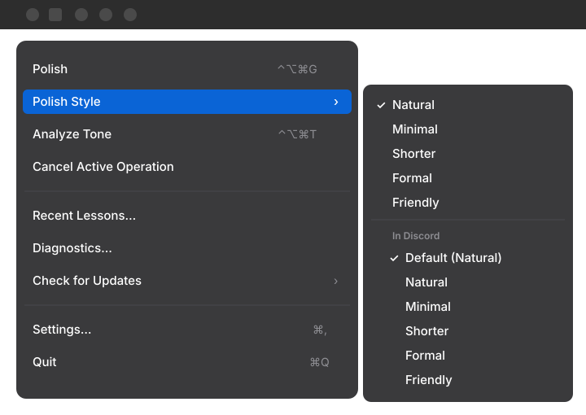

# TextPolish

TextPolish is a macOS menu bar app that improves writing in any app using global hotkeys.

It currently supports two workflows:
- Grammar correction (copy -> correct -> paste -> restore clipboard)
- Tone analysis (copy -> analyze -> show result window -> restore clipboard)



[](https://github.com/kxxil01/TextPolish/actions/workflows/ci.yml)
[](https://github.com/kxxil01/TextPolish/actions/workflows/release.yml)

## Current State (March 2026)

- Platforms: macOS 13+
- Providers: Gemini, OpenRouter, OpenAI, Anthropic
- Tone analysis: production path enabled
- Fallback mode: enabled by one setting, provider-paired fallback
  - Gemini <-> OpenRouter
  - OpenAI <-> Anthropic
- Test suite: 208 tests passing

## Features

- Global hotkeys that work across apps
- Clipboard-safe operations (snapshot + guaranteed restore)
- One Polish action for the selection, or the whole field when nothing is selected
- Polish style: Natural (default) improves wording and joins choppy line breaks so text reads naturally, keeping meaning, tone, and slang; Minimal fixes typos and grammar only and preserves voice and formatting; Shorter cuts filler while keeping every point; Formal makes it polite and professional; Friendly makes it warm and casual
- Custom style (optional, Settings > Advanced > Custom Style): describe a style in your own words, such as "short and direct, as a status update to my manager", and give it a name. It joins the Polish Style menu, can be chosen per app, and can have its own shortcut. It may change the layout, for example into bullet points, but never what the text says
- Style shortcuts (optional, Settings > Hotkeys > Polish with a Style): one shortcut per style, for example ⌃⌥⌘F to Polish as Formal
- Polish translates Indonesian: when the text is mostly Indonesian, Polish writes it in natural English, so one shortcut works for both languages. Detection runs on your Mac. Minimal (terminals and code editors) never translates; turn it off in Settings > Advanced > Translate
- Translate to English (`⌃⌥⌘E`): write in Indonesian or any other language, or a mix, and get natural English back with the same meaning, tone, names, and numbers. Preview and Undo work with it too
- Explain Message (`⌃⌥⌘U`): select a message someone sent you. A panel opens right away and shows what it means in Indonesian (or simple English, Settings > Advanced), how it sounds, and any slang or idioms in it. Then answer from the same panel: click Agree, More Time, Ask, Decline, or Thanks for a quick reply, or type your answer in any language and click Write. The English reply stays editable (fill in any [time] or [date] TextPolish left for you), then click Paste to put it in the app's message box, or Copy. Quick replies never invent times, dates, or promises
- Reply in English (`⌃⌥⌘R`): after Explain Message, type your answer in Indonesian (or a mix), select it, and press `⌃⌥⌘R`. TextPolish writes it as a natural English reply to that message, keeping your meaning, and pastes it. Without a recent Explain, it still writes your draft as an English reply. The explained message is kept in memory for 15 minutes only
- Right-click menu: select text, then right-click > Services > Polish with TextPolish, Translate to English with TextPolish, or Explain with TextPolish. It works in any app with Services, without remembering a shortcut. If the items are missing, turn them on in System Settings > Keyboard > Keyboard Shortcuts > Services > Text
- Recent Polishes (optional, Settings > Advanced, off by default): keeps your last 20 Polishes on this Mac only, readable by your account only. Menu bar > Recent Polishes shows what you wrote and what was pasted, with Copy buttons. Turning it off deletes them
- Undo Last Polish (menu bar): puts back the original text, as long as the polished text is still unchanged in that field
- Style per app: pick a different style for the app you are in from menu bar > Polish Style. Terminals and code editors use Minimal unless you choose otherwise
- Never Change: names, product terms, or words in another language listed in Settings > Advanced stay exactly as written
- Never stuck: if every attempt fails one of TextPolish's checks (a changed number, too many changes, or changed line breaks), the last result opens in the preview with what was flagged, even with Preview off. Paste it if it's right, or Cancel
- Preview before paste (optional, Settings > Advanced): see the changes highlighted, then press Return to paste or Escape to cancel. Not quite right? Click Try Again for another version, or pick another style in the panel to polish the original again without selecting it again
- Learn mode (optional, Settings > Advanced): after each Polish, a small panel explains the main changes, such as "status progress → a progress status: adjective comes before the noun"
- Recent Lessons (menu bar): the last 20 Learn mode explanations, saved only on this Mac, with a Clear button. Changes Learn has explained more than once, such as "needsed → needed (3 times)", are listed first under Watch Out For. At the top, This Week shows how many messages Learn explained, the changes per message compared with last week, and your most repeated change
- Usage and cost (Diagnostics): this month's requests and tokens per model, with an estimate in dollars at list prices for common models. Counted on this Mac only
- Practice (menu bar): a short quiz from your own mistakes. TextPolish shows a phrase you wrote before, such as "already check", you type how you'd write it now, and it shows the fix and why. Repeated mistakes come first
- Diagnostics > Copy Logs copies TextPolish's log lines since launch for a bug report; they never include your text
- Protected token handling for code blocks, inline code, URLs, and mention-like tokens
- Retry logic and timeout bounds for provider requests
- Provider diagnostics and health status in the menu
- Daily usage counters (correction + tone analysis) with a combined status-bar badge
- Sparkle auto-update support in release builds

## Command Line and Shortcuts

TextPolish can polish or translate text from a terminal, a script, or the Shortcuts app. It uses the provider, model, and API key from Settings.

```bash
TP=/Applications/TextPolish.app/Contents/MacOS/TextPolish
$TP polish "i already check the report, pls revise"
echo "tolong cek laporan kemarin" | $TP translate
pbpaste | $TP polish --style formal | pbcopy
```

Styles: `natural`, `minimal`, `shorter`, `formal`, `friendly`, or your Custom style's name. Without `--style`, the default style is used.

Shortcuts app: add a "Run Shell Script" action, set Pass Input to "to stdin", and enter `/Applications/TextPolish.app/Contents/MacOS/TextPolish polish --style formal`.

## Default Hotkeys

- Polish: `Ctrl+Option+Command+G` (`⌃⌥⌘G`)
- Analyze Tone: `Ctrl+Option+Command+T` (`⌃⌥⌘T`)
- Translate to English: `Ctrl+Option+Command+E` (`⌃⌥⌘E`)
- Explain Message: `Ctrl+Option+Command+U` (`⌃⌥⌘U`)
- Reply in English: `Ctrl+Option+Command+R` (`⌃⌥⌘R`)

Hotkeys are configurable from the menu and settings window.

## Supported Providers

- Gemini
  - Default model: `gemini-2.5-flash`
  - Default base URL: `https://generativelanguage.googleapis.com`
- OpenRouter
  - Default model: `google/gemma-3n-e4b-it:free`
  - Default base URL: `https://openrouter.ai/api/v1`
- OpenAI
  - Default model: `gpt-4.1-mini`
  - Default base URL: `https://api.openai.com/v1`
- Anthropic
  - Default model: `claude-haiku-4-5`
  - Default base URL: `https://api.anthropic.com`
- Custom: any service with an OpenAI-compatible API, such as Groq, DeepSeek, Mistral, Together, or a local Ollama or LM Studio
  - Set the base URL (for example `https://api.groq.com/openai/v1` or `http://localhost:11434/v1`) and the model in Settings > Provider > Custom, or click Detect to pick one from the server's model list
  - The API key is optional, since local servers often need none

## Setup

1. Install and open TextPolish.
2. Grant Accessibility permission:
   - System Settings -> Privacy & Security -> Accessibility -> enable TextPolish
3. Configure at least one provider API key from the menu or settings window.

Provider key commands are available for all 4 providers in the menu.

## How It Works

### Grammar correction

1. Capture target app context
2. Snapshot clipboard
3. Send Command+C (Command+A first when the focused field has nothing selected)
4. Wait for copied text
5. Send to active provider
6. Paste corrected text
7. Restore original clipboard

### Tone analysis

1. Capture target app context
2. Snapshot clipboard
3. Send Command+C
4. Wait for copied text
5. Send to active provider
6. Show tone result panel near cursor
7. Restore original clipboard

## Reliability and Safety

- Deadlines are enforced across the whole operation to prevent runaway latency.
- Post-paste timeout is treated as successful completion when paste already happened.
- Escape key handling is maintained across repeated tone-result window open/close cycles.
- Hotkey capture monitors are cleaned up to avoid event monitor leaks.
- Endpoint path normalization handles custom base URLs (including proxy/gateway path prefixes).

## Diagnostics

From the menu, Diagnostics provides:
- Last operation snapshot (provider, model, latency, retries, fallbacks)
- Provider health state
- Active provider checks

Model and API checks include provider-specific request validation.

## Settings Storage

Settings file:
- `~/Library/Application Support/TextPolish/settings.json`

API key resolution order:
1. Keychain (primary service uses app bundle identifier, fallback default service)
2. Settings file value
3. Environment variable

Environment variables:
- Gemini: `GEMINI_API_KEY` or `GOOGLE_API_KEY`
- OpenRouter: `OPENROUTER_API_KEY`
- OpenAI: `OPENAI_API_KEY`
- Anthropic: `ANTHROPIC_API_KEY`

## Build and Run

Build app bundle:

```bash
./scripts/build_app.sh
open ./build/TextPolish.app
```

SwiftPM development:

```bash
swift build
swift run TextPolish
```

Release binary build:

```bash
swift build -c release
```

Run tests:

```bash
swift test
```

Build installer package:

```bash
./scripts/build_pkg.sh
open ./build/TextPolish.pkg
```

## Repository Map

Primary source files are in `src/`.

Key files:
- `src/AppDelegate.swift` - menu bar app lifecycle, menus, diagnostics, updates
- `src/CorrectionController.swift` - correction orchestration
- `src/ToneAnalysisController.swift` - tone orchestration
- `src/Settings.swift` - persisted configuration and defaults
- `src/ModelDetector.swift` - provider model detection logic
- `src/APIEndpointPaths.swift` - normalized endpoint path composition

Tests:
- `Tests/GrammarCorrectionTests/`

## Troubleshooting

- Hotkeys not firing:
  - Re-check Accessibility permission
  - Check for hotkey conflicts in other apps
- Model/API failures:
  - Verify provider key
  - Verify provider model and base URL
  - Run Diagnostics from the menu
- Start at Login issue:
  - Install app in `/Applications`

## Website and Docs

- Website: [textpolish.pages.dev](https://textpolish.pages.dev)
- Development guide: [docs/development.md](docs/development.md)
- Contributing: [CONTRIBUTING.md](CONTRIBUTING.md)

## License

MIT - see [LICENSE](LICENSE)
